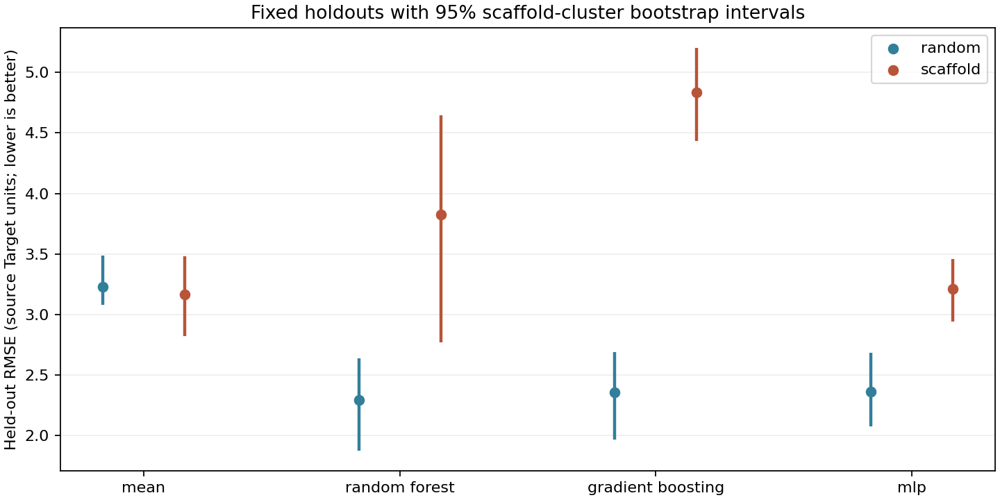
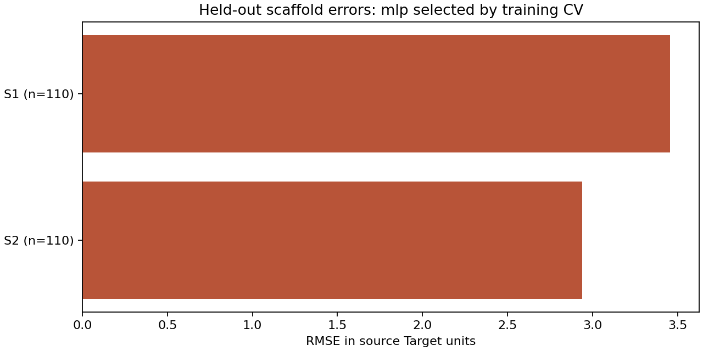
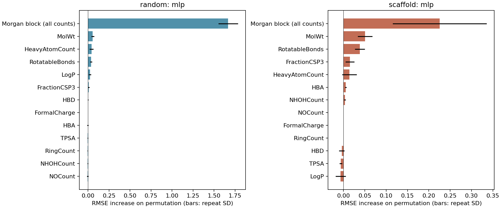

I built a way to compare predictions about tiny particles that carry RNA into cells because I wanted to know whether a prediction that works for familiar particles also works for new kinds. The project uses measurements from lab experiments to estimate how well a proposed particle might deliver its cargo, then checks how often those estimates are wrong.

Lipid nanoparticles are tiny particles that carry RNA into cells. This project takes the structure of their ionizable lipid, the component that changes charge to help delivery, and predicts its measured delivery performance in a laboratory cell experiment. I train several models, then compare a random test set with a test set made of unfamiliar molecular skeletons. That makes it easier to see how much apparent accuracy depends on seeing related molecules during training.

I can also send a batch of proposed structures to a small prediction service and get estimates without rerunning training. The [local service and Azure deployment guide](docs/deployment.md) shows how to start it and try a request. The predictions stay in the original experiment's units and carry the same limits as the benchmark.

I also run the prediction service on Kubernetes, a system that restarts and routes requests to containers. A small team setup API creates namespace, quota, access and network rules that I can review in Git before Argo CD applies them. The [Kubernetes guide](docs/kubernetes.md) explains the local lab and the Azure setup. I have tested the lab in CI; I have not deployed it to a paid Azure cluster.

To try it, install [uv](https://docs.astral.sh/uv/getting-started/installation/), then run the commands below. They download the public measurements, build molecular features, tune the models, and create a local report with plots. The [saved full report](results/reference/report.md) can be read without installing anything.

```bash
git clone https://github.com/jackaI1/lnp-transfection-benchmark.git
cd lnp-transfection-benchmark
uv sync --locked --python 3.11
uv run lnp-benchmark download
uv run lnp-benchmark featurize
uv run lnp-benchmark train
uv run lnp-benchmark evaluate
uv run lnp-benchmark report
open results/run/report.md  # macOS; use any Markdown viewer elsewhere
```

The full run uses one CPU thread per fit. Models and features stay in `results/run/`; it can be deleted after reading the report. No service, account, GPU, browser automation, or private data is needed.

<!-- benchmark:start -->
I ran the full search on **1,100 public lipids**. Both holdouts contain **220 lipids**, but the scaffold holdout has only **2 unseen ring families**. The random holdout shares **6 families** with training; the scaffold holdout shares **0**.

RMSE is prediction error in the source dataset's target units; lower is better. The brackets are 95% confidence intervals from resampling whole scaffold families.

| Model | Random RMSE [95% CI] | Scaffold RMSE [95% CI] | Gap [95% CI] |
|---|---:|---:|---:|
| mean | 3.227 [3.080, 3.488] | 3.166 [2.819, 3.478] | -0.061 [-0.607, 0.353] |
| random forest | 2.289 [1.874, 2.638] | 3.824 [2.768, 4.646] | +1.534 [0.315, 2.572] |
| gradient boosting | 2.354 [1.965, 2.688] | 4.833 [4.433, 5.203] | +2.479 [1.922, 3.061] |
| mlp | 2.363 [2.072, 2.683] | 3.208 [2.940, 3.455] | +0.845 [0.417, 1.278] |

Training cross-validation chose **mlp** for the random split and **mlp** for the scaffold split. For the random split's chosen family, the scaffold-minus-random error gap is **+0.845**. Positive means worse predictions on the scaffold holdout.

These are fixed-split results, not the paper's scores. The intervals condition on the fitted models, and the gap compares different test populations with an unpaired bootstrap. With only two scaffold test families, uncertainty about completely new lipid chemistry is much larger than these intervals can measure. I cannot use this experiment to claim performance in animals, patients, or another cell type.

The scaffold model's largest family error is on `c1cn[nH]c1` (110 lipids, RMSE 3.455). It underpredicts this family by 1.889 target units on average. That systematic bias is hidden by a single overall score.
<!-- benchmark:end -->



All learned models do worse than the constant predictor on this scaffold holdout. I would use this result to question extrapolation, rather than to select new lipids without more experiments.

The [scaffold error table](results/reference/scaffold_errors.csv) shows which families are overpredicted or underpredicted, with sample counts and signed bias. The [plot key](results/reference/scaffold_plot_key.csv) maps each plotted family to its molecular skeleton. This helps distinguish an overall score from a consistent failure on one chemical family.



I also shuffle inputs after training to see which ones the model relies on. The fingerprint is shuffled as one block; individual molecular properties are shuffled separately. Larger bars mean more error when that information is disturbed. The bars show associations, and correlated inputs can hide each other's importance.



The [generated report](results/reference/report.md) includes ranking scores, R², confidence intervals, fit warnings and the full scaffold analysis. [Methods and limitations](docs/methods.md) explain the splitting and uncertainty calculations in detail.

The data comes from [Mehradfar et al.'s LANTERN paper](https://www.nature.com/articles/s44488-026-00007-x), also available as a [preprint](https://arxiv.org/abs/2507.03209). I use its curated [public CSV at a pinned commit](https://github.com/AsalMehradfar/LANTERN/blob/11240f29ef92323649ae60d177b21df77e2d428b/data/AGILE.csv). The underlying experiments were reported by [Xu et al., “Agile platform: a deep learning powered approach to accelerate LNP development for mRNA delivery”](https://www.nature.com/articles/s41467-024-50619-z). The downloader verifies the file's checksum and writes [provenance](data/provenance.json). [Upstream attribution and license](docs/THIRD_PARTY_LICENSES.md) are included.

I reproduce the prediction task and the random-versus-scaffold comparison with my own smaller baseline suite. I preserve the numeric `Target` column exactly as supplied, including negative values; I do not reinterpret it as a percentage. These results are not an exact rerun of the paper's model settings or published scores.

Further down in the code, RDKit turns each SMILES string, a text description of a molecule, into Morgan count fingerprints, which count local atom patterns, and named physicochemical descriptors such as molecular mass and polar surface area. Random forest, gradient boosting and a small multilayer perceptron (MLP, a neural network) use those inputs. A constant mean predictor is included as a reference. Cross-validation holds back training subsets to choose settings without using the final test labels. The scaffold experiment uses Bemis-Murcko skeletons and keeps entire families together in both the outer split and inner cross-validation. Acyclic molecules share one family.

I use the trained scaffold model in a prediction service when I want to compare structures from another script. FastAPI provides the HTTP interface, Docker packages the app, and Azure Container Apps can run it behind an HTTPS address. The weights load separately from Blob Storage and must match a pinned checksum. I can try the complete path locally with Azurite, Microsoft's storage emulator:

```bash
npm install --prefix /tmp/lnp-tools azurite@3.35.0 --no-audit --no-fund
export PATH="/tmp/lnp-tools/node_modules/.bin:$PATH"
# After the training commands above:
uv run python -m lnp_benchmark.artifact
uv run python scripts/serve_local.py
# Open http://127.0.0.1:8000/docs; Ctrl+C stops the server and emulator.
```

The service accepts 1 to 64 molecular strings per request, rejects invalid chemistry and returns predictions in input order with the model identity and checksum. GitHub Actions can train the full model, build and push its image to Azure Container Registry, upload the weights, and deploy the infrastructure from Bicep templates. I verified the emulator path and container in CI; I have not run a paid Azure deployment. The [deployment guide](docs/deployment.md) includes the request format, account setup, workflow steps, costs, cleanup and model-loading checks.

Each stage can be rerun independently:

```bash
uv run lnp-benchmark download --data data/AGILE.csv
uv run lnp-benchmark featurize --data data/AGILE.csv --output results/my-run
uv run lnp-benchmark train --output results/my-run --seed 42
uv run lnp-benchmark evaluate --output results/my-run --bootstrap 2000
uv run lnp-benchmark report --output results/my-run
```

To refresh the committed full experiment, use `--output results/reference` in those four stages, then run `uv run python scripts/update_readme.py`. That script generates the result table above from the saved scores. `--quick` on `train` is a reduced smoke run for development, not a reportable benchmark.

The implementation lives in `src/lnp_benchmark/`: data validation and download, molecular features, split logic, model tuning, evaluation and report generation are separate modules. The [training record](results/reference/training.json), [all CV scores](results/reference/cv_results.csv), [exact partitions and folds](results/reference/assignments.csv), and [held-out predictions](results/reference/predictions.csv) make the figures auditable. `uv.lock` pins dependencies; `source_manifest.json` records source hashes for the saved run.

The original 25 benchmark tests check valid and invalid chemistry, molecular equivalence, stereochemistry, whole-family splitting, grouped cross-validation, duplicate rejection, known metric values, cluster bootstrap behavior, and the complete CLI on a small test fixture. The serving tests add model loading and API checks; the Kubernetes workflow also checks deployment and team isolation in a disposable cluster. The new tests add Blob Storage round trips, checksum and compatibility failures, strict request validation and prediction parity. CI runs the tests, compiles both Bicep templates, builds and exercises the Linux container, audits the saved full experiment against the real public data, and exercises every CLI stage on that data with a reduced training budget.

```bash
# Install Azurite as above before the storage tests.
uv run pytest -q
uv run ruff check src tests scripts
uv run ruff format --check src tests scripts
uv run python scripts/check_reference.py
```
