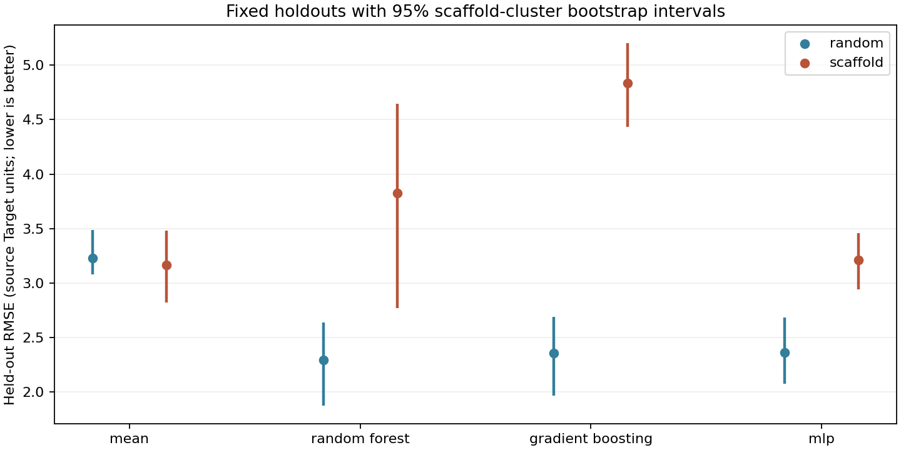
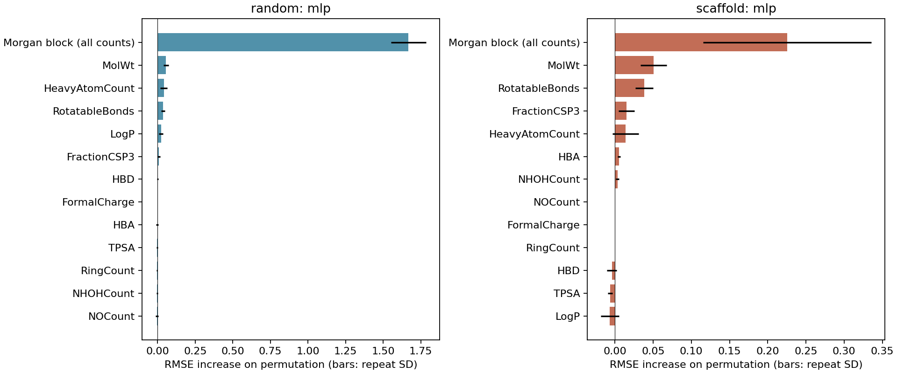
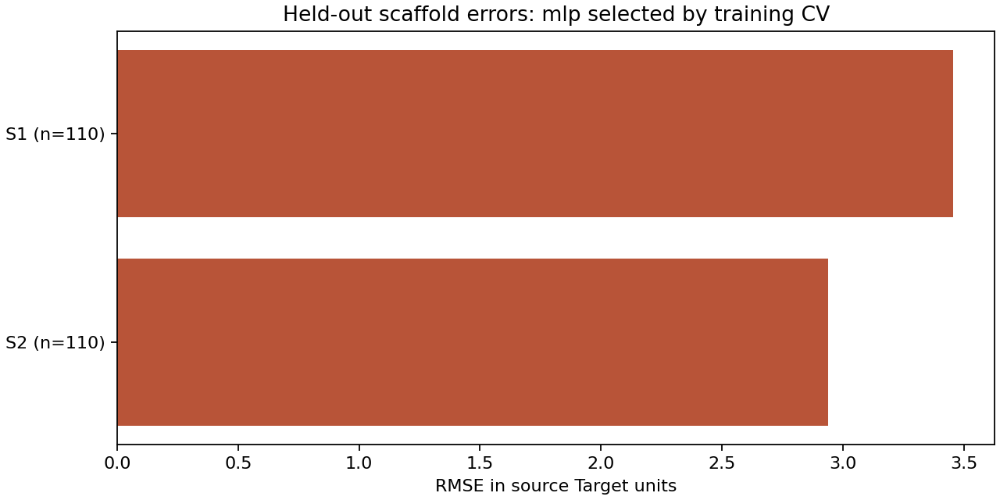

# Generated benchmark results

Generated by `lnp-benchmark report`. Values are read from evaluation.json and training.json.

Dataset: d0ecfd94ec40a7f013af546113520175e70f78045af1798673c2680fe6f23c54. Seed: 42. Quick smoke run: False.

| Split | Train / test rows | Train / test scaffolds | Shared scaffolds | CV choice |
|---|---:|---:|---:|---|
| random | 880 / 220 | 6 / 6 | 6 | mlp |
| scaffold | 880 / 220 | 4 / 2 | 0 | mlp |

| Split | Model | RMSE (95% CI) | MAE | R² | Spearman |
|---|---|---:|---:|---:|---:|
| random | mean | 3.227 (3.080, 3.488) | 2.781 | -0.016 | undefined |
| random | random_forest | 2.289 (1.874, 2.638) | 1.764 | 0.488 | 0.691 |
| random | gradient_boosting | 2.354 (1.965, 2.688) | 1.850 | 0.459 | 0.686 |
| random | mlp | 2.363 (2.072, 2.683) | 1.817 | 0.455 | 0.667 |
| scaffold | mean | 3.166 (2.819, 3.478) | 2.593 | -0.103 | undefined |
| scaffold | random_forest | 3.824 (2.768, 4.646) | 3.109 | -0.609 | 0.060 |
| scaffold | gradient_boosting | 4.833 (4.433, 5.203) | 4.203 | -1.570 | 0.072 |
| scaffold | mlp | 3.208 (2.940, 3.455) | 2.493 | -0.132 | 0.273 |

Positive gaps mean worse scaffold performance. The test populations differ.

| Model | Scaffold minus random RMSE | 95% CI |
|---|---:|---:|
| mean | -0.061 | (-0.607, 0.353) |
| random_forest | 1.534 | (0.315, 2.572) |
| gradient_boosting | 2.479 | (1.922, 3.061) |
| mlp | 0.845 | (0.417, 1.278) |

Conditional on this fixed train/test split and fitted models; not training-seed, split-selection, assay or external-study uncertainty.

Gap intervals subtract independent cluster-bootstrap draws from the two holdouts. Because holdouts can overlap, these are descriptive intervals, not a paired significance test. Few test scaffold families make intervals unstable.

## Scaffold error analysis

The plot key maps each S label to its actual scaffold SMILES. Every family, including small ones, is in scaffold_errors.csv; small-family errors are noisy.

Morgan counts are permuted as a block. Descriptor bars permute one column each. Correlated descriptors can substitute for each other; block sizes differ. Repeat SD bars are permutation variability, not confidence intervals or causal effects.

## Fit warnings

- random/mlp: 36648 occurrences of RuntimeWarning: divide by zero encountered in matmul
- random/mlp: 36648 occurrences of RuntimeWarning: overflow encountered in matmul
- random/mlp: 36648 occurrences of RuntimeWarning: invalid value encountered in matmul
- scaffold/mlp: 31588 occurrences of RuntimeWarning: divide by zero encountered in matmul
- scaffold/mlp: 31588 occurrences of RuntimeWarning: overflow encountered in matmul
- scaffold/mlp: 31588 occurrences of RuntimeWarning: invalid value encountered in matmul

| Unseen scaffold | Rows | RMSE | Mean signed bias |
|---|---:|---:|---:|
| `c1cn[nH]c1` | 110 | 3.455 | -1.889 |
| `C1COCCN1` | 110 | 2.940 | +0.138 |

Positive bias means overprediction; negative means underprediction.

## Evaluation warnings

- RuntimeWarning: divide by zero encountered in matmul
- RuntimeWarning: invalid value encountered in matmul
- RuntimeWarning: overflow encountered in matmul
